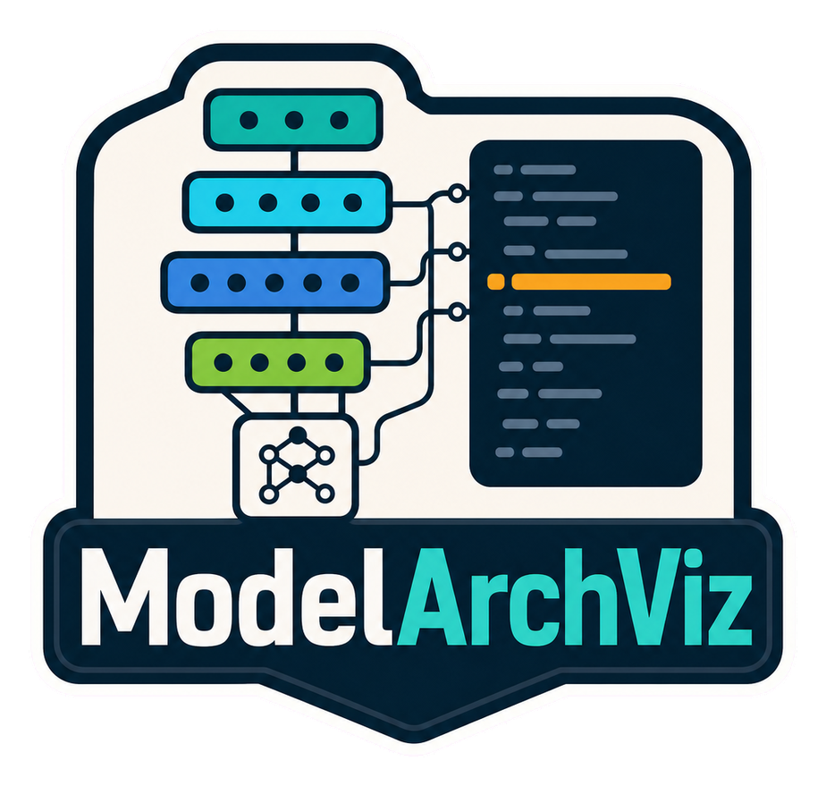

<p align="center">
  
  <br />
  <!-- repo-tagline:start -->
  <strong>🧭 Explore model architectures beside the code that defines them 🧭</strong>
  <!-- repo-tagline:end -->
</p>

ModelArchViz shows how neural network architectures map to code. Select a
model and a layer to highlight its PyTorch or JAX implementation alongside
the architecture diagram and source paper or model card.

## Try it

Open [ModelArchViz](https://modelarchviz.tsilva.eu/), choose a model, and
expand an architecture block. Select one of its nodes and switch between
PyTorch and JAX to compare the matching code.

## Run locally

```bash
git clone https://github.com/tsilva/modelarchviz.git
cd modelarchviz
pnpm install --frozen-lockfile
pnpm dev --port auto
```

Open the local URL printed by the development server.

See [development](docs/development.md) for notebook generation, build
commands, and optional chat configuration. The
[EmbeddingGemma 2 example](docs/embeddinggemma2.md) documents its architecture
and fidelity checks.

## License

[MIT License](LICENSE).
