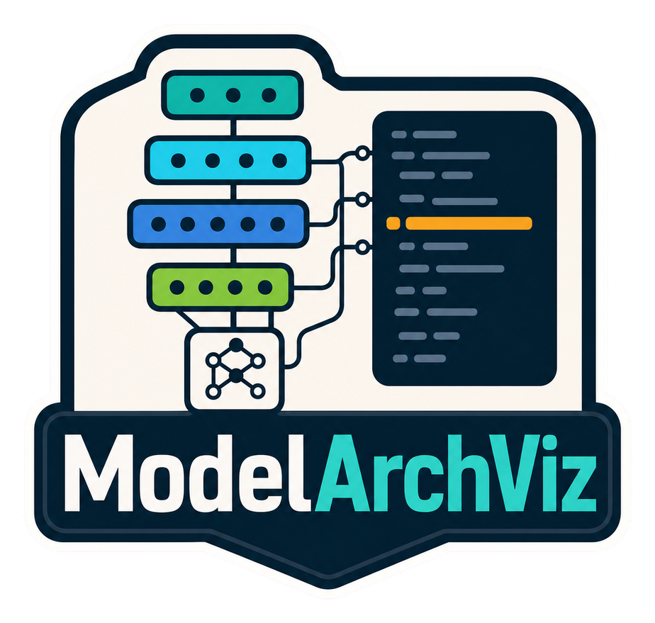

<p align="center">
  
  <br />
  <!-- repo-tagline:start -->
  <strong>🧭 Explore model architectures beside the code that defines them 🧭</strong>
  <!-- repo-tagline:end -->
</p>

ModelArchViz is a Next.js app for inspecting neural network architecture examples alongside PyTorch/JAX code and source-paper context.

Use it to switch between embedded model specs, expand architecture blocks, select layers, and see the matching code lines highlighted in the editor.

## Install

```bash
git clone https://github.com/tsilva/modelarchviz.git
cd modelarchviz
pnpm install --frozen-lockfile
pnpm dev --port auto
```

Open the local URL printed by the development server.

## Commands

```bash
pnpm generate:model-artifacts  # generate the UI source map, Colab notebooks, and PDF worker
pnpm dev --port auto
pnpm build                     # generate artifacts and build the production app
pnpm start                     # serve the production build after pnpm build
pnpm typecheck                 # generate artifacts and run TypeScript checks
```

Local builds skip Sentry source-map uploads. Runtime error reporting still uses the configured DSN.

## Optional chat

The chat pane calls AgentBridge during local development. Production and Vercel preview deployments call OpenRouter directly with their own server-side `OPENROUTER_API_KEY`, defaulting to `deepseek/deepseek-v4.1-flash-1017`. `OPENROUTER_MODEL` overrides the model; `OPENROUTER_APP_URL` and `OPENROUTER_APP_NAME` set request attribution.

<!-- agent-vault-agentbridge:read:start -->
## Local AgentBridge through Agent Vault

For protected-profile validation and locked-runtime prerequisites, see
[local Vault maintenance](docs/local-agent-vault.md).

On a configured trusted Mac:

```sh
pnpm dev:vault --port auto
pnpm agentbridge:app-check
pnpm agentbridge:check
pnpm test:agentbridge
```

`dev:vault` starts the actual local app with only a public placeholder and a
scoped Agent Vault session. The existing `/api/chat` route sends its chat requests
through the proxy to AgentBridge. Its JSON reply and code-highlight context stay
unchanged, with local default `openai/gpt-6.1-terra`, the existing 900-token cap
and 60-second request timeout. Production retains its separate model selection.

The app mapping is bundle `local-modelarchviz-agentbridge`, service
`modelarchviz-agentbridge-chat`, with owner-only metadata at
`~/.config/infisical/agentbridge-clients/modelarchviz-app.json`. It permits only
GET models and POST chat on the reviewed loopback gateway. AgentBridge's existing
upstream route handles provider credentials; no source keys are fetched here.

The opt-in launcher uses Webpack for sandbox compatibility, runs the maintained
model-artifact generator, and prints the OS-assigned loopback URL. Existing
servers are preserved. No model notebook is executed. Native instance/CA/runtime
pins, process-local proxy trust and placeholder checks apply to every Node worker.
The sandbox blocks dotenv and credential-manager access and direct network
connections. Fetch rejects alternate origins, management paths and redirects,
and withholds provider errors without retries or fallback.

App sessions last at most 30 minutes. Stop the owned server normally when done;
expiry/auth failures never trigger raw injection or direct-provider fallback.
The normal launch commands, production model, production delivery and Sentry
configuration remain unchanged. The trusted launcher and full-access host remain
outside the child sandbox; starting the app does not authorize arbitrary prompts.

`agentbridge:app-check` makes only a model-catalog GET through the app bundle.
The separate `agentbridge:check` keeps the more restricted bundle `local-modelarchviz-agentbridge-read`,
service `modelarchviz-agentbridge-models`, for GET `/api/v1/models` on
`127.0.0.1:8082`. The owner-only local metadata profile is
`~/.config/infisical/agentbridge-clients/modelarchviz-read.json`.

The profile validates this repository's native Development source identity and
pins the existing routing helper's digest. No application key or Sentry token
is fetched. The local gateway accepts public placeholders; AgentBridge's own
upstream credential route remains responsible for provider authentication.
The sandboxed Node client imports the reviewed app routing helper, requires
`agentbridge_public_placeholder`, and enables proxy support explicitly.
Its fixed request returns only catalog size and whether the configured default
is advertised. A missing catalog entry is informational; a catalog does not
prove that an inference request will succeed or that upstream login is valid.

Outbound access is limited to the local proxy. Home reads are limited to the
reviewed runtime, public CA and required client/config files. Only the pinned
Node runtime can be executed inside the sandbox; Keychain service lookup is
blocked. The trusted launcher and other full-access host processes remain
outside that isolation boundary. The instance and CA are pinned without
changing system trust, and sessions last at most ten minutes.

The separate model-only profile permits only read-only catalog access. Use
`dev:vault` for actual local chat. Other image-generation, embedding, file and
MCP endpoints are not enabled. Missing/changed bindings and failed checks
stop without raw-key or direct-network fallback. Other app defaults,
production delivery, Sentry settings/uploads and other service profiles remain
unchanged. Run `pnpm test:agentbridge` after modifying this client or profile.
<!-- agent-vault-agentbridge:read:end -->

Trusted provisioning installs the official checksum-reviewed Node v24.22.1 Darwin ARM64 runtime alongside existing runtimes under `~/.config/infisical/runtimes/node-v24.22.1-darwin-arm64`, plus an owner-only metadata profile. The profile records version 1, repository/root, native project/environment/path identity, bundle, fixed loopback URL and proxy, absolute runtime/CLI/public-CA paths, CA fingerprint, routing-helper path/digest and the documented app default model. Review source or profile changes explicitly before replacing these pins; ordinary checks never approve new scope automatically.

## Notes

Build tooling pins `glob` 14.0.2, `minimatch` 11.0.1, `path-scurry` 3.0.0 and the nonrecursive matcher 1.0.1 to address glob cancellation and pattern amplification advisories. The seven-day package hold and existing exception are retained; the new exceptions cover only these exact user-approved versions.

Private project considerations and accepted future work live in root
`INBOX.md` when present. Use the repository procedure of `$private-skills_inbox-capture` to read and author it as one
workflow, including clarification and reconciliation with current code and
docs. `INBOX.md` and `.local/repo-inbox/` migration sources are Git-ignored,
local to this checkout, and require independent backup. Obsidian sources remain
read-only; deleting a fully migrated source is a manual user action.

Sentry 11 uses the `@sentry/nextjs/config` build entry point and enables logs by default. Client and server integrations retain tracing and replay settings and explicitly disable personal, request, queue, and content data collection.
The paper viewer initializes PDF.js with its document parameter object; generated artifacts keep the served worker synchronized with the installed PDF.js version.

Secret scanning checks changed commits. After a rewritten push whose previous commit is unavailable or is not an ancestor, it scans the full current branch history. Pull requests still require a valid base revision. Run `python3 .github/scripts/test_secret_scan.py` to verify this handling without credentials.

- Model identity, route, paper, and source metadata live in `app/model-routes.ts`; architecture nodes and code highlights live in `app/model-arch-viz-app.tsx`. The optional chat pane uses `app/api/chat/route.ts`.
- Canonical model source files live in `app/model-notebooks` as Jupytext-style `py:percent` notebooks.
- `pnpm generate:model-artifacts` writes cleaned Python sources into `app/generated/model-sources.ts`, Colab notebooks to `public/notebooks`, and the pinned PDF.js worker to `public/pdf.worker.min.mjs`.
- `# %% [notebook-only]` cells are included in generated notebooks for examples and smoke tests, but excluded from generated site preview code.
- The code pane reads the generated source map; edit the canonical notebook sources instead of editing generated artifacts directly.
- Colab buttons use `NEXT_PUBLIC_GITHUB_REPOSITORY` and `NEXT_PUBLIC_GITHUB_BRANCH` when set. They default to `tsilva/modelarchviz` and `main`.
- Current examples range from MLPs and recurrent/Seq2Seq models through classic CNNs, Inception, ResNet, U-Net, BERT, GPT-2, ViT, CLIP, Mamba, and EmbeddingGemma 2.
- [EmbeddingGemma 2](docs/embeddinggemma2.md) adds a bidirectional text backbone, expandable vision/audio encoders, and matching PyTorch/JAX notebooks. Defaults match the released architecture; runnable smoke tests use smaller random-weight models.
- Paper panes render the checked-in PDFs under `public/papers`; releases documented by an official model card, such as EmbeddingGemma 2, show model-card context and source links.
- No database, server-side storage, or user-data persistence is configured. Google Analytics and Sentry provide analytics, error monitoring, tracing, and replay.
- `NEXT_PUBLIC_SITE_URL` is optional and sets the absolute base URL for social metadata, sitemap, and robots output. It falls back to `https://modelarchviz.tsilva.eu`.
- Authoring brand assets live under `assets/brand`, runtime web and SEO assets live under `public/brand/web-seo`, and the root `logo.png` is used for repository and README display.

## Chat environments

Development uses AgentBridge. Set `AGENTBRIDGE_BASE_URL` to its API root
(default `http://127.0.0.1:8082/api/v1`); `AGENTBRIDGE_API_KEY` is optional.
Existing development model choices are retained, with raw upstream model IDs
prefixed by `openrouter/` on outbound AgentBridge requests.

Production builds (`NODE_ENV=production`) and Vercel preview/production targets
use OpenRouter's HTTPS API directly. Keep a separate production key in the
`modelarchviz-production` Infisical project; the delivery workflow syncs only the
production allowlist. Development credentials and local gateway configuration
are not used by the production backend. A missing production key returns a
clear unavailable response, with no fallback to AgentBridge.

Production defaults to `deepseek/deepseek-v4.1-flash-1017`, with reasoning disabled
and a 900-token response limit. Set `OPENROUTER_MODEL` in the target environment
to use a different OpenRouter model ID such as `provider/model`.

Production secrets are delivered through the pinned shared GitHub Actions workflow. The standalone signed Infisical relay triggers synchronization and deployment; see [production delivery](docs/production-delivery.md) for scope and recovery.

Production delivery keeps Vercel secret isolation enabled and distinguishes public configuration from private credentials; see [production delivery](docs/production-delivery.md).

## License

[MIT License](LICENSE).

New Codex captures without an explicit destination use `$private-skills_inbox-capture` with
its Obsidian default; explicitly address this repository for direct repo capture.
