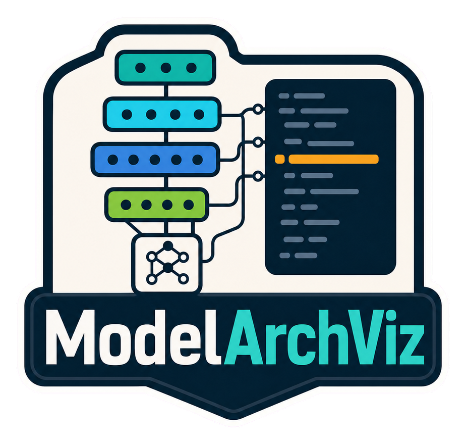

<p align="center">
  
  <br />
  <!-- repo-tagline:start -->
  <strong>🧭 Explore model architectures beside the code that defines them 🧭</strong>
  <!-- repo-tagline:end -->
</p>

ModelArchViz is a Next.js app for inspecting neural network architecture examples alongside PyTorch/JAX code and source-paper context.

Use it to switch between embedded model specs, expand architecture blocks, select layers, and see the matching code lines highlighted in the editor.

## Install

```bash
git clone https://github.com/tsilva/modelarchviz.git
cd modelarchviz
pnpm install --frozen-lockfile
pnpm dev --port auto
```

Open the local URL printed by the development server.

## Commands

```bash
pnpm generate:model-artifacts  # generate the UI source map, Colab notebooks, and PDF worker
pnpm dev --port auto
pnpm build                     # generate artifacts and build the production app
pnpm start                     # serve the production build after pnpm build
pnpm typecheck                 # generate artifacts and run TypeScript checks
```

## Optional chat

The chat pane calls AgentBridge during local development. Production and Vercel preview deployments call OpenRouter directly with their own server-side `OPENROUTER_API_KEY`, defaulting to `deepseek/deepseek-v4.1-flash`. `OPENROUTER_MODEL` overrides the model; `OPENROUTER_APP_URL` and `OPENROUTER_APP_NAME` set request attribution.

## Notes

Sentry 11 uses the `@sentry/nextjs/config` build entry point and enables logs by default. Client and server integrations retain tracing and replay settings and explicitly disable personal, request, queue, and content data collection.
The paper viewer initializes PDF.js with its document parameter object; generated artifacts keep the served worker synchronized with the installed PDF.js version.

Secret scanning checks changed commits. After a rewritten push whose previous commit is unavailable or is not an ancestor, it scans the full current branch history. Pull requests still require a valid base revision. Run `python3 .github/scripts/test_secret_scan.py` to verify this handling without credentials.

- Model identity, route, paper, and source metadata live in `app/model-routes.ts`; architecture nodes and code highlights live in `app/model-arch-viz-app.tsx`. The optional chat pane uses `app/api/chat/route.ts`.
- Canonical model source files live in `app/model-notebooks` as Jupytext-style `py:percent` notebooks.
- `pnpm generate:model-artifacts` writes cleaned Python sources into `app/generated/model-sources.ts`, Colab notebooks to `public/notebooks`, and the pinned PDF.js worker to `public/pdf.worker.min.mjs`.
- `# %% [notebook-only]` cells are included in generated notebooks for examples and smoke tests, but excluded from generated site preview code.
- The code pane reads the generated source map; edit the canonical notebook sources instead of editing generated artifacts directly.
- Colab buttons use `NEXT_PUBLIC_GITHUB_REPOSITORY` and `NEXT_PUBLIC_GITHUB_BRANCH` when set. They default to `tsilva/modelarchviz` and `main`.
- Current examples range from MLPs and recurrent/Seq2Seq models through classic CNNs, Inception, ResNet, U-Net, BERT, GPT-2, ViT, CLIP, Mamba, and EmbeddingGemma 2.
- [EmbeddingGemma 2](docs/embeddinggemma2.md) adds a bidirectional text backbone, expandable vision/audio encoders, and matching PyTorch/JAX notebooks. Defaults match the released architecture; runnable smoke tests use smaller random-weight models.
- Paper panes render the checked-in PDFs under `public/papers`; releases documented by an official model card, such as EmbeddingGemma 2, show model-card context and source links.
- No database, server-side storage, or user-data persistence is configured. Google Analytics and Sentry provide analytics, error monitoring, tracing, and replay.
- `NEXT_PUBLIC_SITE_URL` is optional and sets the absolute base URL for social metadata, sitemap, and robots output. It falls back to `https://modelarch.tsilva.eu`.
- Authoring brand assets live under `assets/brand`, runtime web and SEO assets live under `public/brand/web-seo`, and the root `logo.png` is used for repository and README display.

## License

No license file is present in this repository yet.


## Chat environments

Development uses AgentBridge. Set `AGENTBRIDGE_BASE_URL` to its API root
(default `http://127.0.0.1:8082/api/v1`); `AGENTBRIDGE_API_KEY` is optional.
Existing development model choices are retained, with raw upstream model IDs
prefixed by `openrouter/` on outbound AgentBridge requests.

Production builds (`NODE_ENV=production`) and Vercel preview/production targets
use OpenRouter's HTTPS API directly. Keep a separate production key in the
`modelarchviz-production` Infisical project; the delivery workflow syncs only the
production allowlist. Development credentials and local gateway configuration
are not used by the production backend. A missing production key returns a
clear unavailable response, with no fallback to AgentBridge.

Production defaults to `deepseek/deepseek-v4.1-flash`, with reasoning disabled
and a 900-token response limit. Set `OPENROUTER_MODEL` in the target environment
to use a different OpenRouter model ID such as `provider/model`.

Production delivery keeps Vercel secret isolation enabled and distinguishes public configuration from private credentials; see [production delivery](docs/production-delivery.md).
